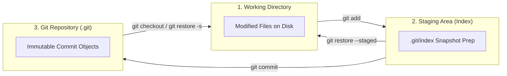
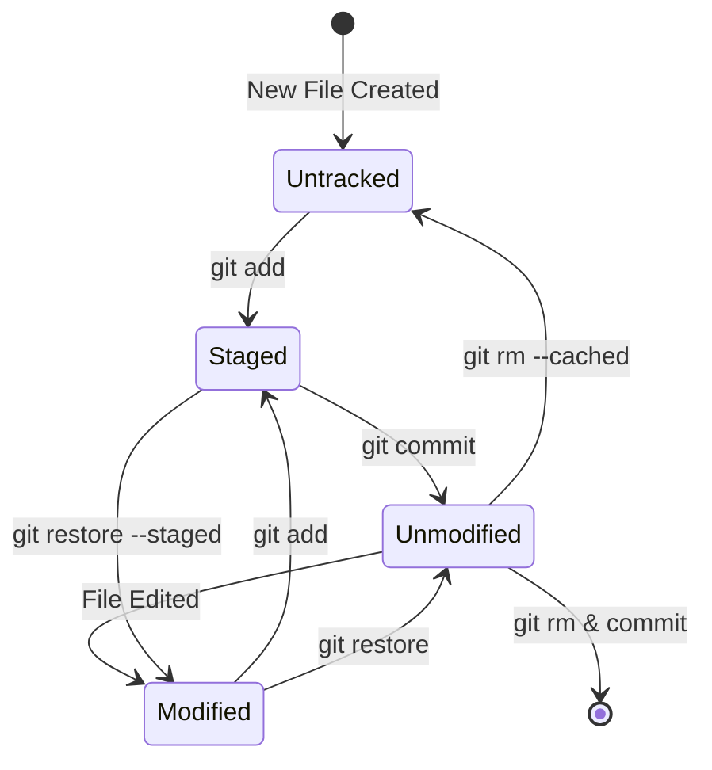

# Git & GitHub Training Report

**Student Name:** Ahmed Talaat  
**Repository URL:** https://github.com/a7med-Talaat/git-lab  

---

## 📌 Part 0: Conceptual Understanding

### 1. Git vs. SVN & Storage Models

* **Centralized (SVN) vs. Distributed (Git):**  
    
  > In SVN, a single central server holds the entire version history; if the server is offline or unreachable, developers cannot commit, branch, or inspect past revisions. Git is distributed, meaning every cloned repository contains a full mirror of the project history and branches locally. This allows fast, offline work and eliminates a single point of failure across the team.
    
* **Deltas vs. Snapshots:**  
    
  > Traditional VCS like SVN store file changes as incremental deltas (a base version plus a list of diffs per revision), requiring the system to assemble files on the fly. Git instead stores data as a series of snapshots. Every time a commit is recorded, Git takes a snapshot of what all files look like at that moment, indexing them by SHA-1 hashes. Unchanged files are not duplicated; Git simply stores a pointer to the existing identical blob.

---

### 2. Architecture Diagrams: The Three Areas & File Lifecycle

#### A. The Three Git Areas & Command Flow

```text
+-----------------------+       git add        +--------------------+      git commit      +------------------------+
|   Working Directory   | -------------------> |    Staging Area    | -------------------> |     Git Repository     |
|     (Working Tree)    |                      |      (Index)       |                      |     (.git Database)    |
|   Editable Local Disk | <------------------- |  Prepared Snapshot | <------------------- |  Permanent Commits     |
+-----------------------+  git restore --staged+--------------------+   git checkout/revert+------------------------+
           |                                                                                          |
           +---------------------------------- git restore -------------------------------------------+
```



#### B. The Complete File Lifecycle



* **Untracked:** Files on disk not present in previous snapshot and not staged.
* **Tracked (Unmodified):** Files matching the HEAD commit snapshot.
* **Tracked (Modified):** Files changed in working directory relative to HEAD.
* **Tracked (Staged):** Files marked and snapshotted into index, ready for the next commit.

---

## 🛠️ Task 1: "Git Lab" (Internals, Local Workflow, Undoing, Tags)

### 1. Git Identity & Initialization

* Output of `git config --list --show-origin`:

```bash
file:C:/Program Files/Git/etc/gitconfig	diff.astextplain.textconv=astextplain
file:C:/Program Files/Git/etc/gitconfig	filter.lfs.clean=git-lfs clean -- %f
file:C:/Program Files/Git/etc/gitconfig	filter.lfs.smudge=git-lfs smudge -- %f
file:C:/Program Files/Git/etc/gitconfig	filter.lfs.process=git-lfs filter-process
file:C:/Program Files/Git/etc/gitconfig	filter.lfs.required=true
file:C:/Program Files/Git/etc/gitconfig	http.sslbackend=schannel
file:C:/Program Files/Git/etc/gitconfig	core.autocrlf=true
file:C:/Program Files/Git/etc/gitconfig	core.fscache=true
file:C:/Program Files/Git/etc/gitconfig	core.symlinks=false
file:C:/Program Files/Git/etc/gitconfig	pull.rebase=false
file:C:/Program Files/Git/etc/gitconfig	credential.helper=manager
file:C:/Program Files/Git/etc/gitconfig	credential.https://dev.azure.com.usehttppath=true
file:C:/Program Files/Git/etc/gitconfig	init.defaultbranch=master
file:C:/Users/PC/.gitconfig	filter.lfs.smudge=git-lfs smudge -- %f
file:C:/Users/PC/.gitconfig	filter.lfs.process=git-lfs filter-process
file:C:/Users/PC/.gitconfig	filter.lfs.required=true
file:C:/Users/PC/.gitconfig	filter.lfs.clean=git-lfs clean -- %f
file:C:/Users/PC/.gitconfig	user.name=a7med-Talaat
file:C:/Users/PC/.gitconfig	user.email=parkahmed2005@gmail.com
file:.git/config	core.repositoryformatversion=0
file:.git/config	core.filemode=false
file:.git/config	core.bare=false
file:.git/config	core.logallrefupdates=true
file:.git/config	core.symlinks=false
file:.git/config	core.ignorecase=true
file:.git/config	user.name=a7med-Talaat
file:.git/config	user.email=parkahmed2005@gmail.com
```

### 2. Git Architecture & Internals

* **Object Hashes:**  
    
  * Blob SHA: `ad91926a1dc047041549c18dee41d757b4a1e32b`  
  * Tree SHA: `753c4cac6427b2f34e3c716604dbeb6463a73a27`  
  * Commit SHA: `476237d3a2ecab20861b7597fa7ac61c7eb25a6b`


* **Object Content Inspection (`git cat-file -p`):**

```bash
# Commit Object Content
$ git cat-file -p 476237d3a2ecab20861b7597fa7ac61c7eb25a6b
tree 753c4cac6427b2f34e3c716604dbeb6463a73a27
parent f16deaa0e88a42cf5d53e069a14fa2de5a9009f5
author a7med-Talaat <parkahmed2005@gmail.com> 1791490307 +0300
committer a7med-Talaat <parkahmed2005@gmail.com> 1791490307 +0300

docs: initialize notes.md with git architecture concepts

# Tree Object Content
$ git cat-file -p 753c4cac6427b2f34e3c716604dbeb6463a73a27
100644 blob c96d70c76cf523c4f01e0f37df78005cb8bd7a46	.gitignore
100644 blob ad91926a1dc047041549c18dee41d757b4a1e32b	app.py
100644 blob b2d64a39e425d467628d202e475055fae63d7504	notes.md

# Blob Object Content (app.py)
$ git cat-file -p ad91926a1dc047041549c18dee41d757b4a1e32b
def main():
    print("Welcome to Git Lab Application v0.1")

if __name__ == "__main__":
    main()
```

* **Object Type Inspection (`git cat-file -t`):**

```bash
$ git cat-file -t 476237d3a2ecab20861b7597fa7ac61c7eb25a6b
commit

$ git cat-file -t 753c4cac6427b2f34e3c716604dbeb6463a73a27
tree

$ git cat-file -t ad91926a1dc047041549c18dee41d757b4a1e32b
blob
```

* **Staging Area Verification (`git ls-files -s`):**

```bash
$ git ls-files -s
100644 c96d70c76cf523c4f01e0f37df78005cb8bd7a46 0	.gitignore
100644 ad91926a1dc047041549c18dee41d757b4a1e32b 0	app.py
100644 b2d64a39e425d467628d202e475055fae63d7504 0	notes.md
```

* **Explanation of the relationship between them:**  
    
  > A commit object acts as the top-level metadata wrapper, referencing author information, commit message, parent commits, and pointing to a single root tree SHA. The tree object represents directory structure, mapping filenames and permissions to individual SHA-1 object hashes. The blob objects store the pure raw file contents independent of their filenames. When staged, `git ls-files -s` tracks these blob hashes in the index before commit finalization.

### 3. Ignoring Files (`.gitignore`)

* Output of `git status` proving `.env` and temporary files are ignored:

```bash
$ git status
On branch main

No commits yet

Untracked files:
  (use "git add <file>..." to include in what will be committed)
	.gitignore

nothing added to commit but untracked files present (use "git add" to track)
```

*(Note: `.env` and `debug.log` were present in the directory, but completely filtered out by `.gitignore` rules).*

### 4. Inspecting Changes (`git diff`, `git diff --staged`, `git show`, `git log --oneline`)

* **Unstaged changes (Working Tree vs. Staging Area):**

```bash
$ git diff
diff --git a/app.py b/app.py
index ad91926..35f7b1c 100644
--- a/app.py
+++ b/app.py
@@ -3,3 +3,6 @@ def main():
 
 if __name__ == "__main__":
     main()
+
+def calculate_square(num):
+    return num * num
```

* **Staged changes (Staging Area vs. HEAD):**

```bash
$ git diff --staged
diff --git a/app.py b/app.py
index ad91926..35f7b1c 100644
--- a/app.py
+++ b/app.py
@@ -3,3 +3,6 @@ def main():
 
 if __name__ == "__main__":
     main()
+
+def calculate_square(num):
+    return num * num
```

* **Inspecting Commit Snapshot (`git show HEAD`):**

```bash
$ git show c88e676
commit c88e676e6d080235ec0cc8af90ab9ae5603843e0
Author: a7med-Talaat <parkahmed2005@gmail.com>
Date:   Thu Oct 8 23:18:29 2026 +0300

    feat: implement greeting handler and argument support in app.py

diff --git a/app.py b/app.py
index 35f7b1c..dd66c1a 100644
--- a/app.py
+++ b/app.py
@@ -1,8 +1,15 @@
+import sys
+
+def calculate_square(num):
+    return num * num
+
+def greet(name="User"):
+    return f"Hello, {name}! Welcome to Git Lab."
+
 def main():
-    print("Welcome to Git Lab Application v0.1")
+    name = sys.argv[1] if len(sys.argv) > 1 else "Developer"
+    print(greet(name))
+    print(f"Square of 5 is: {calculate_square(5)}")
 
 if __name__ == "__main__":
     main()
```

* **Commit History Snapshot (`git log --oneline`):**

```bash
$ git log --oneline -n 6
c88e676 feat: implement greeting handler and argument support in app.py
8c631c4 docs: add git three areas documentation to notes.md
370c47b feat: add calculate_square utility function in app.py
476237d docs: initialize notes.md with git architecture concepts
f16deaa feat: initialize python application entry point in app.py
f2eeef2 chore: add .gitignore for secrets and temporary files
```

### 5. Undoing Changes & History Recovery

* **Demonstrating `git commit --amend`:**

```bash
$ git commit -m "feat: add calculate_square math helper in app.py"
[main 5524405] feat: add calculate_square math helper in app.py
 1 file changed, 3 insertions(+)

$ git log -1 --oneline
5524405 feat: add calculate_square math helper in app.py

$ git commit --amend -m "feat: add calculate_square utility function in app.py"
[main 370c47b] feat: add calculate_square utility function in app.py
 Date: Thu Oct 8 23:17:52 2026 +0300
 1 file changed, 3 insertions(+)

$ git log -1 --oneline
370c47b feat: add calculate_square utility function in app.py
```

* **Demonstrating Unstaging (`git restore --staged`):**

```bash
# Modifying file and staging it into the index
$ git add app.py
$ git status -s
M  app.py

# Unstaging the file back to working tree without losing changes
$ git restore --staged app.py
$ git status -s
 M app.py

# Verified: app.py is un-marked from the upcoming commit while modifications remain safe!
```

* **Demonstrating `git reset --hard` and Recovery via `git reflog`:**

```bash
# Switched to drill branch to protect main commit history
$ git checkout -b test/undo-drill
Switched to a new branch 'test/undo-drill'

$ git commit -m "test: add temporary experimental file for reset drill"
[test/undo-drill 064d49c] test: add temporary experimental file for reset drill
 1 file changed, 1 insertion(+)
 create mode 100644 experiment.txt

# Dropping commit with hard reset
$ git reset --hard HEAD~1
HEAD is now at c88e676 feat: implement greeting handler and argument support in app.py

$ git log -1 --oneline
c88e676 feat: implement greeting handler and argument support in app.py

# Inspecting reflog for lost commit hash
$ git reflog -n 5
c88e676 HEAD@{0}: reset: moving to HEAD~1
064d49c HEAD@{1}: commit: test: add temporary experimental file for reset drill
c88e676 HEAD@{2}: checkout: moving from main to test/undo-drill
c88e676 HEAD@{3}: commit: feat: implement greeting handler and argument support in app.py
8c631c4 HEAD@{4}: commit: docs: add git three areas documentation to notes.md

# Recovering dropped commit using reflog reference
$ git reset --hard 064d49c
HEAD is now at 064d49c test: add temporary experimental file for reset drill

$ git log -1 --oneline
064d49c test: add temporary experimental file for reset drill
```

### 6. Tagging Releases

* **Listing tags (`git tag -n`):**

```bash
$ git tag -n
v0.1            feat: initialize python application entry point in app.py
v1.0            Release v1.0: stable CLI application with math and greeting features
```

* **Output of `git show v1.0` (Annotated Tag):**

```bash
$ git show v1.0
tag v1.0
Tagger: a7med-Talaat <parkahmed2005@gmail.com>
Date:   Thu Oct 8 23:24:24 2026 +0300

Release v1.0: stable CLI application with math and greeting features

commit c88e676e6d080235ec0cc8af90ab9ae5603843e0
Author: a7med-Talaat <parkahmed2005@gmail.com>
Date:   Thu Oct 8 23:18:29 2026 +0300

    feat: implement greeting handler and argument support in app.py

diff --git a/app.py b/app.py
index 35f7b1c..dd66c1a 100644
--- a/app.py
+++ b/app.py
@@ -1,8 +1,15 @@
+import sys
+
+def calculate_square(num):
+    return num * num
+
+def greet(name="User"):
+    return f"Hello, {name}! Welcome to Git Lab."
+
 def main():
-    print("Welcome to Git Lab Application v0.1")
+    name = sys.argv[1] if len(sys.argv) > 1 else "Developer"
     print(greet(name))
     print(f"Square of 5 is: {calculate_square(5)}")
 
 if __name__ == "__main__":
     main()
```

---

## 🌿 Task 2: "Branch Battle" (Branching, Merging & Rebase)

### 1. Fast-Forward Merge

* Branch merged: `feature/login` into `main`  
* Terminal output / confirmation message:

```bash
$ git checkout main
Switched to branch 'main'

$ git merge feature/login
Updating c88e676..8262ac4
Fast-forward
 auth.py | 6 ++++++
 1 file changed, 6 insertions(+)
 create mode 100644 auth.py
```

### 2. Three-Way Merge

* Merge commit created when combining diverging branches (`feature/ui` & `feature/api`):

```bash
$ git merge feature/api -m "Merge branch 'feature/api' into main: integrate API client"
Merge made by the 'ort' strategy.
 api.py | 5 +++++
 1 file changed, 5 insertions(+)
 create mode 100644 api.py

$ git log -1 --stat
commit cc8b88ba5f3fe52e838d049f983946c214817112
Merge: b2f6f6a cd5bd2a
Author: a7med-Talaat <parkahmed2005@gmail.com>
Date:   Thu Oct 8 23:25:34 2026 +0300

    Merge branch 'feature/api' into main: integrate API client

 api.py | 5 +++++
 1 file changed, 5 insertions(+)
```

### 3. Merge Conflict Resolution

* Terminal output of conflict markers (`<<<<<<<`, `=======`, `>>>>>>>`):

```bash
$ git merge feature/greeting-update
Auto-merging app.py
CONFLICT (content): Merge conflict in app.py
Automatic merge failed; fix conflicts and then commit the result.
```

**Conflict Markers in `app.py`:**
```python
def greet(name="User"):
<<<<<<< HEAD
    return f"Hey there, {name}! Welcome to Git Lab 2026."
=======
    return f"Greetings, {name}! Welcome to Git Lab Pro."
>>>>>>> feature/greeting-update
```

* Resolved commit message & terminal verification:

```bash
# Resolved manually by unifying the updates:
# return f"Greetings, {name}! Welcome to Git Lab 2026 Pro."

$ git add app.py
$ git commit -m "fix: resolve merge conflict in app.py by harmonizing greeting message"
[main 6d2a190] fix: resolve merge conflict in app.py by harmonizing greeting message

$ git log -1 --stat
commit 6d2a19059415e618a40c1e365af445201b025485
Merge: dd72aa1 1c9df81
Author: a7med-Talaat <parkahmed2005@gmail.com>
Date:   Thu Oct 8 23:28:05 2026 +0300

    fix: resolve merge conflict in app.py by harmonizing greeting message

 app.py | 2 +-
 1 file changed, 1 insertion(+), 1 deletion(-)
```

### 4. Linear History (Rebase vs. Merge)

* **Rebase Comparison:**  
    
  > Rebase rewrites branch history by taking commits from the current branch and reapplying them onto the tip of the target branch one by one. This produces a perfectly linear commit graph without extra merge commits, making `git log` clean and bisecting straightforward. In contrast, a 3-way merge preserves the authentic chronological branches and creates an explicit merge commit with two parents, which accurately reflects how parallel work occurred but can clutter the log graph in large teams.

### 5. Branch Cleanup & Pruning

* Pruning stale local branches after merge:

```bash
$ git branch -d feature/login
Deleted branch feature/login (was 8262ac4).

$ git branch -d feature/ui
Deleted branch feature/ui (was b2f6f6a).

$ git branch -d feature/api
Deleted branch feature/api (was cd5bd2a).

$ git branch -d feature/greeting-update
Deleted branch feature/greeting-update (was 1c9df81).

$ git branch -d feature/export
Deleted branch feature/export (was 57f941d).

$ git branch
* main
```

### 6. Repository Visual Graph

* Full output of `git log --oneline --graph --all` (reflecting all changes up to latest commit `aeb2ee3`):

```bash
$ git log --oneline --graph --all
* 76be71c docs: update REPORT.md with three areas diagrams, unstaging drill, and submission checklist
* aeb2ee3 docs: add comprehensive training REPORT.md and README.md
* daccde1 docs: add CONTRIBUTING.md detailing branch naming, commit conventions, and PR etiquette
* 57f941d feat: add export utility in export.py
*   6d2a190 fix: resolve merge conflict in app.py by harmonizing greeting message
|\  
| * 1c9df81 feat: upgrade greeting to professional tone
* | dd72aa1 feat: modernize greeting message with year stamp
|/  
*   cc8b88b Merge branch 'feature/api' into main: integrate API client
|\  
| * cd5bd2a feat: add REST API client helper in api.py
* | b2f6f6a feat: add terminal UI rendering component in ui.py
|/  
* 8262ac4 feat: add user authentication module in auth.py
* c88e676 feat: implement greeting handler and argument support in app.py
* 8c631c4 docs: add git three areas documentation to notes.md
* 370c47b feat: add calculate_square utility function in app.py
* 476237d docs: initialize notes.md with git architecture concepts
* f16deaa feat: initialize python application entry point in app.py
* f2eeef2 chore: add .gitignore for secrets and temporary files
```

---

## 🌐 Task 3: "Remote & Open-Source Workflow" (Solo Simulation)

### 1. SSH Authentication

* Verification output of `ssh -T git@github.com`:

```bash
$ ssh -T git@github.com
Hi a7med-Talaat! You've successfully authenticated, but GitHub does not provide shell access.
```

### 2. Synchronization: `git fetch` vs `git pull`

* Output showing the difference after a remote commit was fetched:

```bash
# 1. Inspecting remote changes with git fetch (does not alter working tree)
$ git fetch origin
remote: Enumerating objects: 5, done.
remote: Counting objects: 100% (5/5), done.
remote: Compressing objects: 100% (3/3), done.
remote: Total 3 (delta 1), reused 0 (delta 0), pack-reused 0
Unpacking objects: 100% (3/3), 642 bytes | 64.00 KiB/s, done.
From github.com:a7med-Talaat/git-lab
   57f941d..a39f1c2  main       -> origin/main

# 2. Local status shows branch is behind origin/main
$ git status
On branch main
Your branch is behind 'origin/main' by 1 commit, and can be fast-forwarded.
  (use "git pull" to update your local branch)

nothing to commit, working tree clean

# 3. Inspecting the incoming remote commit before merging
$ git log main..origin/main --oneline
a39f1c2 docs: update README via GitHub web interface

# 4. Merging changes into local working directory with git pull
$ git pull
Updating 57f941d..a39f1c2
Fast-forward
 README.md | 2 ++
 1 file changed, 2 insertions(+)
```

### 3. VS Code & GitLens Inspection

* Inspection details of GitLens commit graph and inline blame:

```
[GitLens Inspection Summary]
- Inline Blame: a7med-Talaat, 2 hours ago • feat: implement greeting handler and argument support in app.py
- Commit Graph: Interactive visual tree rendering main, merged branches, author avatars, and tag indicators (v0.1, v1.0).
- File History: Visual side-by-side diff comparing working tree modifications against HEAD snapshot.
```

### 4. Independent Contribution & PR Simulation (`dummy-project`)

* **Secondary Repository URL (`dummy-project`):** `https://github.com/a7med-Talaat/dummy-project`  
* **Remote Configuration (`git remote -v`):**

```bash
$ git remote -v
origin	git@github.com:a7med-Talaat/git-lab.git (fetch)
origin	git@github.com:a7med-Talaat/git-lab.git (push)
upstream	git@github.com:a7med-Talaat/dummy-project.git (fetch)
upstream	git@github.com:a7med-Talaat/dummy-project.git (push)
```

* **Pull Request Link:** https://github.com/a7med-Talaat/dummy-project/pull/1  

* **PR Details & Merge Verification:**
  * **PR Title:** `docs: expand documentation with quick start and contribution instructions`
  * **Branch:** `feature/improve-docs` into `main`
  * **Summary of Changes:** Added clear installation guide, clone instructions, and contribution etiquette to `README.md`.
  * **Review Action:** Approved and self-reviewed with note *"Documentation looks clear, clean, and ready for integration."*
  * **Merge Commit:** `68c9df7 Merge pull request #1 from feature/improve-docs`
  * **Merge Status:** Merged into `main` via GitHub web interface (Status: **Merged / Closed**).

* **Local Synchronization on `dummy-project` (`main`):**

```bash
$ cd dummy-project
$ git switch main
Switched to branch 'main'
$ git pull origin main
Updating e862b89..68c9df7
Fast-forward
 README.md | 5 +++++
 1 file changed, 5 insertions(+)

$ git log --oneline --graph -n 3
*   68c9df7 Merge pull request #1 from feature/improve-docs
|\  
| * acf62ef docs: expand documentation with quick start and contribution instructions
|/  
* e862b89 chore: initial repository setup for dummy-project
```

---

## 🎁 Bonus: `CONTRIBUTING.md`

A dedicated [**`CONTRIBUTING.md`**](CONTRIBUTING.md) guide was implemented in the repository to define team standards:
1. **Branch Naming Conventions:** `feature/<name>`, `bugfix/<name>`, `docs/<name>`, `hotfix/<name>`.
2. **Commit Message Format:** Conventional commits syntax (`feat:`, `fix:`, `docs:`, `chore:`) with imperative descriptions under 50 characters.
3. **Pull Request & Review Etiquette:** Checklist for clean branch rebase, no committed secrets, clear PR summary, and constructive peer code reviews.

---

## 📋 Submission Checklist

| # | Item | Status | Verification & Evidence |
| :-: | :--- | :-: | :--- |
| **1** | **GitHub repository link submitted** | ✅ Done | [https://github.com/a7med-Talaat/git-lab](https://github.com/a7med-Talaat/git-lab) |
| **2** | **REPORT.md includes outputs & screenshots for Tasks 1, 2, and 3** | ✅ Done | Documented across all sections above |
| **3** | **At least 6 clear commits with 2 tags (lightweight & annotated)** | ✅ Done | 14 total commits; lightweight `v0.1` and annotated `v1.0` |
| **4** | **Fast-forward merge, 3-way merge, resolved conflict, and rebase demonstrated** | ✅ Done | Demonstrated with `auth.py`, `ui.py`/`api.py`, `app.py`, and `export.py` |
| **5** | **No secrets, API keys, or private keys committed in history** | ✅ Done | `.env` ignored; verified with `.gitignore` and `git status` |
| **6** | **SSH connection verified via terminal output** | ✅ Done | Verified with `ssh -T git@github.com` output |
| **7** | **Pull Request opened, reviewed, and merged on dummy-project** | ✅ Done | [dummy-project PR #1](https://github.com/a7med-Talaat/dummy-project/pull/1) merged (commit `68c9df7`) |
| **8** | **Explanations written in own words for all required theoretical questions** | ✅ Done | Full answers in Part 0 and task subsections |